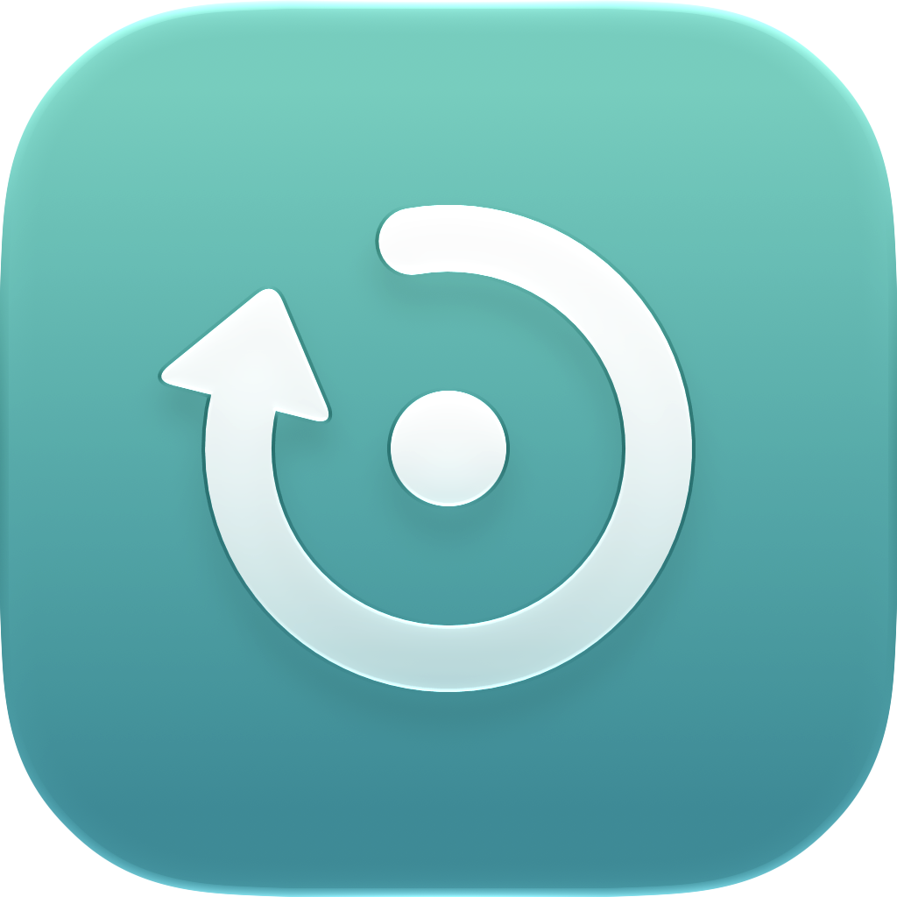
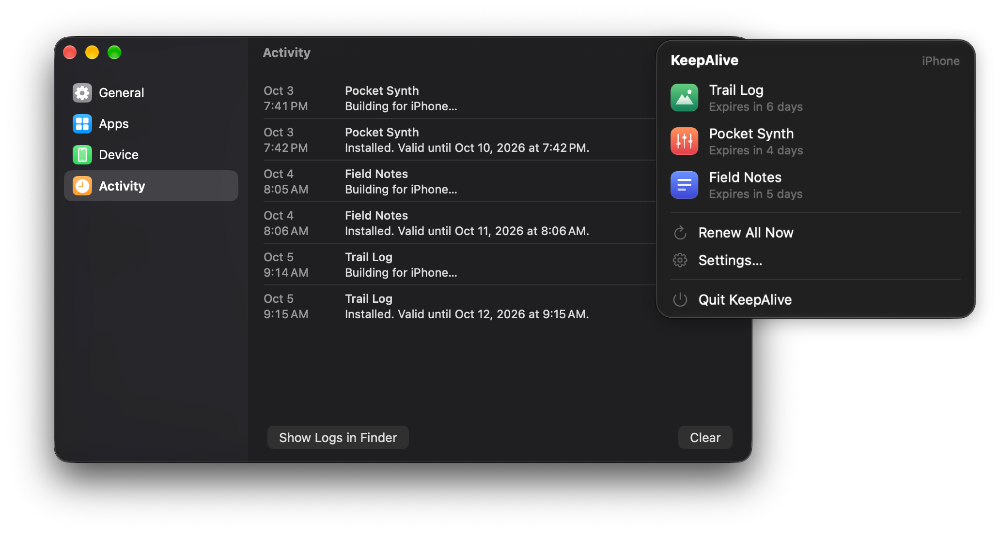

<p align="center">
  
</p>

<h1 align="center">KeepAlive</h1>

<p align="center">
  Keeps the iOS apps you build yourself installed on your iPhone and iPad, without a paid developer account.
</p>

<p align="center">
  <a href="https://github.com/oli-zr/keepalive/releases/latest"></a>
  
  <a href="https://github.com/oli-zr/keepalive/actions/workflows/build.yml"></a>
  <a href="LICENSE"></a>
</p>

```sh
curl -fsSL https://raw.githubusercontent.com/oli-zr/keepalive/main/scripts/install.sh | sh
```

<p align="center">
  <sub>Paste this into Terminal to install or update KeepAlive. <a href="#installation">Other ways to install</a></sub>
</p>

<p align="center">
  
</p>

Apps signed with a free Apple Account stop opening after seven days. KeepAlive is a
small menu bar app for your Mac that rebuilds and reinstalls them before that happens,
whenever your iPhone or iPad is on the same Wi‑Fi network. Once it is set up, you don’t
have to think about it again.

- Renews early, by default once an app is three days old, so there are four days of buffer.
- Works with several devices, for example an iPhone and an iPad.
- Installs over Wi‑Fi or a cable using Apple’s own tools. Your data in the apps is kept.
- Uses little energy: builds wait for a power adapter unless an app expires within a day.
- Works with any Xcode project, including Flutter and other cross-platform projects.
- Updates itself, and is available in English, German, Spanish, French, Japanese,
  Portuguese and Simplified Chinese. [Corrections are welcome.](../../issues/new?template=translation.yml)

## Why KeepAlive

Tools like AltStore or SideStore re-sign app files. KeepAlive builds your own projects instead.

<table>
  <tr>
    <td width="33%" align="center" valign="top">
      <h3>🔒<br>Your password stays yours</h3>
      <p>KeepAlive uses the Apple Account you signed in to Xcode. No other app or server ever sees your password.</p>
    </td>
    <td width="33%" align="center" valign="top">
      <h3>🛠️<br>Built from your code</h3>
      <p>Each renewal is a fresh build of your project, so the app on your device is always your latest version.</p>
    </td>
    <td width="33%" align="center" valign="top">
      <h3>💻<br>Stays on your Mac</h3>
      <p>No server, no sign-up, no tracking. KeepAlive only asks GitHub whether there is a new version.</p>
    </td>
  </tr>
</table>

## What you need

- A Mac with macOS 14 Sonoma or later
- [Xcode](https://apps.apple.com/app/xcode/id497799835) 15 or later from the App Store
- A free Apple Account
- An iPhone or iPad

## Installation

1. Open **Terminal**: press ⌘ Space, type `Terminal`, and press Return.
2. Paste this line and press Return:

   ```sh
   curl -fsSL https://raw.githubusercontent.com/oli-zr/keepalive/main/scripts/install.sh | sh
   ```

The command downloads the latest version, checks that it is complete and unchanged,
moves KeepAlive to your Applications folder, and opens it. KeepAlive then appears as an
icon in the menu bar at the top of your screen. You can read
[what the command does](scripts/install.sh) before running it.

<details>
<summary>Install without Terminal</summary>

1. Download `KeepAlive.zip` from the [latest release](../../releases/latest) and open it.
2. Move KeepAlive to your Applications folder and open it.
3. macOS blocks KeepAlive the first time, because it is not notarized. Notarizing needs a
   paid developer account. Open System Settings → Privacy & Security, scroll down, and
   click **Open Anyway** next to the message about KeepAlive.

</details>

<details>
<summary>Build it yourself</summary>

This requires Xcode 26 or later.

```sh
git clone https://github.com/oli-zr/keepalive.git
cd keepalive
scripts/build_app.sh
open build/KeepAlive.app
```

</details>

<details>
<summary>Check where a download comes from</summary>

Every release is built by GitHub Actions from the tagged source code, and GitHub signs a
record of that build. With the [GitHub CLI](https://cli.github.com) you can confirm that a
download came from this repository and was not changed afterwards:

```sh
gh attestation verify KeepAlive.zip --repo oli-zr/keepalive
```

</details>

## Setup

### 1. Sign in to Xcode (once)

Open Xcode, choose Xcode → Settings → **Apple Accounts**, click **+**, and sign in with
your Apple Account. In Xcode 26 and earlier, the section is called **Accounts**.

### 2. Connect your iPhone or iPad (once per device)

1. Open Xcode, connect the device to your Mac with a cable, and unlock it. When it asks
   whether to trust this computer, tap **Trust**.
2. On the device, turn on Settings → Privacy & Security → **Developer Mode** and restart it
   when asked. The option appears once the device has been connected to Xcode.
3. With Xcode 27, that’s all: from now on, the device is reachable over Wi‑Fi too. With
   Xcode 26 or earlier, also choose Window → Devices and Simulators, select the device,
   and turn on **Connect via network**.

### 3. Prepare your project (once per app)

1. Open the project in Xcode.
2. Select the app target, open **Signing & Capabilities**, turn on **Automatically manage
   signing**, and choose your Personal Team.
3. Choose your device at the top of the window and click Run (▶).
4. The first time, the app does not open yet. On the device, open Settings → General →
   VPN & Device Management, tap your Apple Account, and tap **Trust**.

For Flutter projects, run `flutter build ios` once first. In KeepAlive, you can later enter
`flutter build ios --release --config-only` under **Before Build**, so the iOS project is
up to date before each build.

### 4. Add the app to KeepAlive

1. Click the KeepAlive icon in the menu bar and choose **Settings…**.
2. Under **Apps**, click **Add App…** and choose the project folder.
3. Under **General**, turn on **Open at Login**, so KeepAlive keeps running.

That’s it. KeepAlive installs the app right away and renews it from then on. If you use
more than one device, turn on each one under **Devices**. To put an app on only some of
them, click ⓘ next to the app under **Apps**.

## If something doesn’t work

Click the KeepAlive icon to see the state of each app. **Settings… → Activity** lists
everything KeepAlive did, including the full messages.

| Message | What to do |
| --- | --- |
| *iPhone is not reachable* | Connect the device to the same Wi‑Fi as your Mac. KeepAlive tries again on its own. |
| *Unlock iPhone once…* | Unlock the device. After a restart, this is needed once before apps can be installed. |
| *No provisioning profile could be created* | Do [step 3 of the setup](#3-prepare-your-project-once-per-app) for this project. |
| *A free Apple Account can have three of your own apps on a device…* | Remove one of them from the device, or turn the app off for that device in KeepAlive. See [Limits](#limits). |
| *A free Apple Account can create ten new app IDs per week…* | Wait a few days. KeepAlive tries again on its own. |
| *Xcode was not found* | Install Xcode from the App Store, or choose it under Settings → General. |
| The device is not listed under **Devices** | Do [step 2 of the setup](#2-connect-your-iphone-or-ipad-once-per-device) again, and click the refresh button. |

Still stuck? [Open an issue](../../issues/new/choose) and include the relevant lines from
`~/Library/Logs/KeepAlive/`.

## Limits

These are limits Apple sets for free accounts, not limits of KeepAlive.

- At most three of your own apps can be installed on a device at the same time.
- At most ten new app IDs can be created in seven days.
- Some capabilities, such as push notifications or iCloud, are not available.
- Your Mac needs to be awake and on the same network as your devices at least once
  every few days.

<details>
<summary>How it works</summary>

Every 30 minutes, at a time macOS considers convenient, and after your Mac wakes or
joins a network, KeepAlive checks whether an app is due. For each app that is due, it:

1. Looks for your devices with `devicectl`.
2. Removes Xcode’s cached provisioning profile for that app, so Apple issues a new one
   that is valid for seven days.
3. Builds the Release configuration with `xcodebuild -allowProvisioningUpdates`.
4. Installs the app with `devicectl device install app` on every device where it is due.
   A device that is new to your Personal Team is registered with it first.
5. Deletes the build files. Nothing is added to your project folder.

A device that is away or locked does not hold up the others. It gets the app as soon as
it is back.

Settings are stored in `~/Library/Application Support/KeepAlive`, and logs in
`~/Library/Logs/KeepAlive`. Together they take up less than a megabyte.

</details>

<details>
<summary>Uninstall</summary>

1. Click the KeepAlive icon and choose **Quit KeepAlive**.
2. Move KeepAlive from your Applications folder to the Trash.
3. To remove its settings and logs as well, run this in Terminal:

   ```sh
   rm -rf ~/Library/Application\ Support/KeepAlive ~/Library/Logs/KeepAlive
   ```

The apps on your devices stay installed until they expire.

</details>

## License

MIT. See [LICENSE](LICENSE).

KeepAlive is an independent project and is not affiliated with or endorsed by Apple Inc.
Xcode, iPhone and macOS are trademarks of Apple Inc.
